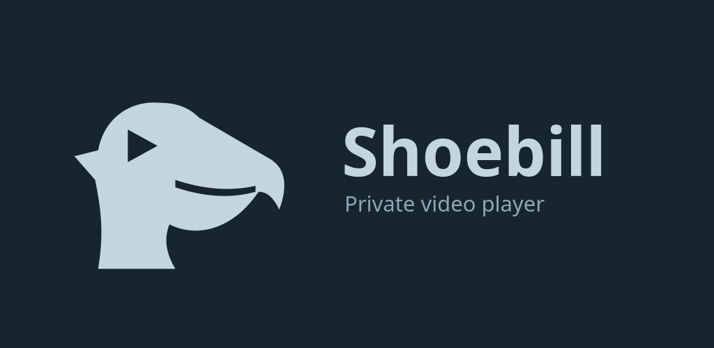
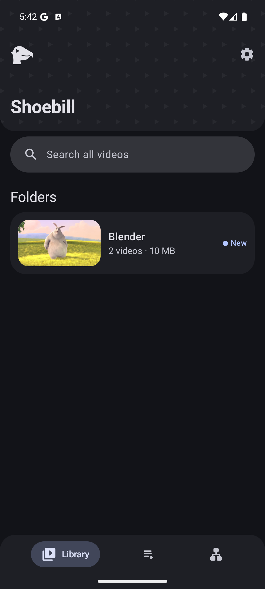
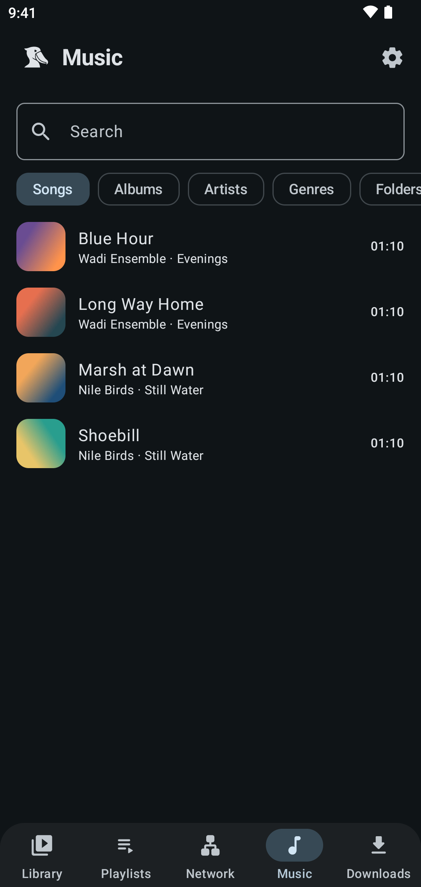
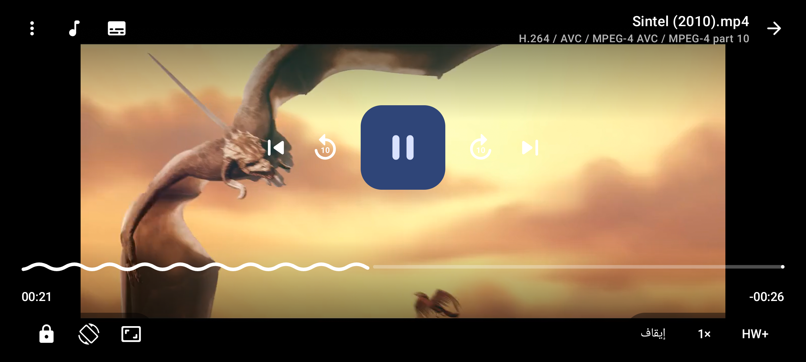
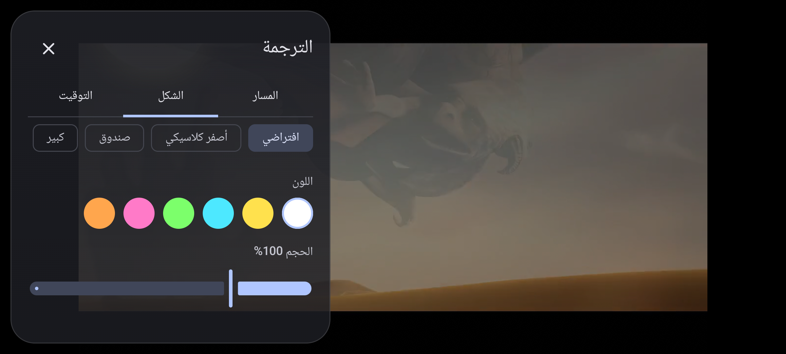

<p align="center"></p>

<p align="center">
  A private video player for Android, built on <a href="https://mpv.io">mpv</a>, with an encrypted vault.<br>
  English and Arabic interface. No ads, no accounts, no tracking.
</p>

<p align="center"><i>The shoebill stands dead still in the Nile marshes of Sudan and watches. It tells nobody what it saw.</i></p>

<p align="center" dir="rtl">مشغّل فيديو خاص لأندرويد، مع خزنة مشفّرة. بدون إعلانات ولا حسابات ولا تتبّع.</p>

<p align="center">
  <a href="https://github.com/altyb/shoebill/releases/latest"></a>
  <a href="https://apps.obtainium.imranr.dev/redirect?r=obtainium://add/https://github.com/altyb/shoebill"></a>
  <!-- Turn on once listed. docs/badges/fdroid.png, play.png -->
</p>

<p align="center">
  <a href="../../releases/latest"></a>
  
  <a href="../../releases"></a>
  <a href="https://github.com/altyb/shoebill/stargazers"></a>
  <a href="LICENSE"></a>
</p>

<p align="center">
  
  
</p>
<p align="center">
  
  
</p>

Sister app: [Hudhud Keyboard](https://github.com/altyb/hudhud).

## Features

**Languages:** English and Arabic. The layout follows the language (right-to-left in Arabic); pick one in
Settings, or let it follow the phone.

**Player**
- Plays what mpv plays: HEVC 10-bit, H.264, VP9, TrueHD/EAC3/DTS, ASS/PGS subtitles, network streams (http, HLS, rtsp).
- Gestures for seeking, volume and brightness; double-tap to skip; speed; audio and subtitle tracks.
- Screen lock, picture-in-picture, background audio, resume where you stopped, playlists.

- Chapter marks on the seek bar. Deinterlace, picture controls (brightness, contrast, saturation, gamma) and scale filters.
- Frame stepping and a seek preview.

**Music**
- Music tab: albums, artists, genres, playlists and a queue. The mini player sits in the tab bar and grows into the now-playing page.
- Background playback with notification controls. Album art is cached.
- Android Auto browsing. Written to the spec; not yet tried in a car.

**Downloader** (GitHub build only; Google Play does not allow it)
- Paste a link to download video or audio. Choose the format, download playlists, keep subtitles and thumbnails.
- Private mode, cookies for sites that need a login, proxy and speed limit. The downloader updates itself in the background.

**Network and TV**
- Browse SMB, WebDAV, SFTP and FTP sources and play from them. Passwords are encrypted under a key in the phone's security chip. SFTP checks the host key on every connection.
- Cast to DLNA TVs. The video is served only while casting, at a random address on your Wi-Fi. Vault files can never be cast.

**Audio**
- Audio delay, and an equalizer on phones that support Android's audio effects.
- ReplayGain: reads the loudness tags and turns loud tracks down. It never turns anything up.

**Subtitles**
- Search OpenSubtitles, SubDL and Jimaku (with your own free API keys).
- Sync automatically from the audio (`.srt` files, audio your phone can decode). It changes nothing if it is not sure.
- Style them: colour, size, outline, background box, bold, presets.
- Drag a subtitle on screen to move it; pinch it to resize it. Manual timing sync.
- Old Arabic `windows-1256` files are converted automatically.

**Vault**
- Hide videos and photos inside the app. Moving a file in removes it from the gallery; moving it out puts it
  back in its original folder.
- Its own PIN (4–16 digits), separate from the phone's lock screen. Fingerprint optional.
- Decoy PIN opens a second vault; wipe PIN erases the real one.
- 5 wrong PINs lock it (30 s, doubling up to 1 h). Changing the phone's clock does not end the wait.
- Videos play straight from the encrypted file; nothing decrypted is written to disk.
- Encrypted backup and restore (`.shoebillvault` file, password-protected).
- Screenshots and screen recording blocked inside the vault.

## Install

- **GitHub:** download the APK from [Releases](../../releases/latest). Android 8.0 or newer. Most phones take `arm64-v8a`; older ones `armeabi-v7a`; `universal` runs anywhere and is the one to use if unsure or when updating from 0.4.0.
- **[Obtainium](https://github.com/ImranR98/Obtainium):** add `https://github.com/altyb/shoebill` to get updates.
- **F-Droid app:** add my own repo under Settings, Repositories: `https://altyb.github.io/fdroid/repo?fingerprint=4882F491E55FA2B5630EBA1409087C2DC2F404E8786813D0E60B13569CC1040A`. These are the same signed APKs as the GitHub releases. The apps are not in the main F-Droid catalogue yet.

Use the GitHub APK. The Google Play version cannot ask for "All files access", so moving
files into the vault shows Android's delete dialog each time.

**Installed a version before 0.4.0?** It will not update, because the app ID changed. In the old app open Vault settings and tap Back up. Install the new app, restore the file there, and check your files before removing the old one.

## Privacy

The app has no analytics, no ads and no account. It goes online only when you use it to: search or download
subtitles (OpenSubtitles, SubDL, Jimaku), or play a network link you entered. Android backup is off, so app data
does not leave the phone. Full policy: [PRIVACY.md](PRIVACY.md).

## How the vault is protected

- Each file is encrypted with AES-256-GCM (Tink streaming AEAD) under its own key. File names, thumbnails and the
  index are encrypted too.
- File keys are wrapped by a vault key, which is wrapped by a key inside the phone's security chip (Android
  Keystore, StrongBox when available). A copy of the app's storage cannot be opened on another device.
- The PIN is checked with an HMAC keyed inside the security chip, so stolen PIN hashes cannot be brute-forced
  off the phone.
- Backups use PBKDF2 (600,000 iterations) and Tink streaming AEAD.

The code has had an internal review, not an independent audit. The decoy vault protects against a casual look,
not against a forensic examination of the phone.

## Build

JDK 17+ and the Android SDK.

```
./gradlew assembleFullRelease    # GitHub / F-Droid build: one APK per CPU plus a universal one
./gradlew bundlePlayRelease      # Google Play build
```

Each release has one version code per APK: release number × 10 + slot (universal 0, `armeabi-v7a` 1, `arm64-v8a` 2, `x86_64` 3).
`-PdevAbis=x86_64` builds one APK for the emulator instead of splits.

Startup profile: `./gradlew :app:generateFullReleaseBaselineProfile` with a phone (Android 13+) over USB; commit the file it writes under `app/src/`.

| Flavor | Difference |
|---|---|
| `full` | Asks once for "All files access", so moving files into the vault deletes the originals silently. |
| `play` | No "All files access" (Play policy); Android shows its delete dialog when you move files in. |

Release signing reads `~/.secrets/shoebill-release.properties`
(`storeFile`, `storePassword`, `keyAlias`, `keyPassword`); without it, release builds use the debug key.

Tests:
- `cd vault-tests && ./gradlew test` (vault crypto, PIN, backup format)
- `cd subs-tests && ./gradlew test` (subtitle search and parsing)
- `cd library-tests && ./gradlew test` (library logic). GitHub Actions runs this plus a debug build on every push to main.
- `qa/e2e.py`: end-to-end player checks on a device or emulator. `qa/make-media.sh` creates the test videos;
  build with `-PdevAbis=x86_64` for the emulator.

## Known limits

- The dialer code does not work on Xiaomi HyperOS: the system blocks the broadcast for third-party apps. Long-press the logo instead. The Google Play build has no dialer code.
- Automatic subtitle sync listens for loudness, so films with constant music or noise may get no result. Use the manual buttons there.
- Casting has no remote control beyond stop, and has not been tried on many TV brands.
- DLNA server browsing is not built; SMB shares and direct links are.
- After the wipe PIN the real vault is gone for good; the PIN pad stays and the decoy PIN keeps working.
  To start a new real vault, clear the app's data.

## How it was made

Much of this code was written with an AI coding assistant (Claude) under my direction. If something looks wrong, please open an issue.

## Credits

- [mpv](https://mpv.io) and [FFmpeg](https://ffmpeg.org), through [libmpv-android](https://github.com/jarnedemeulemeester/libmpv-android).
- [Tink](https://github.com/tink-crypto/tink-java) for encryption.
- Screenshots show *Sintel* and *Big Buck Bunny* © Blender Foundation, [CC BY 3.0](https://creativecommons.org/licenses/by/3.0/).

## License

GPL-3.0-or-later. See [LICENSE](LICENSE).

Rights holders can report a problem to altybanony@gmail.com.
